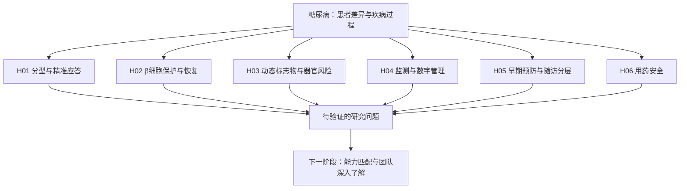

> **B02最新状态｜2026-11-11**：ADA已由6条扩展为27条，新增21条、补全3条结果；其中13条正式论文摘要、11条会议摘要结果、1条官方报道、2条结果待核。详见[[wenxin/糖尿病热点知识地图/10 ADA第二轮补充与热点地图|第二轮热点地图与逐项来源]]。下文首轮范围及A01—A06旧状态保留作B01历史，以B02新记录为当前状态。

# 糖尿病热点知识地图｜首轮

> **先看这一个问题：糖尿病研究正在怎样从“平均患者、单次指标”走向“疾病异质性、动态变化与持续干预”？**
>
> 这是本轮材料形成的组织视角，不代表年度所有研究的统一趋势。下列六条主线来自定向样本，尚不足以给出“2026最热”排名。

[[wenxin/糖尿病热点知识地图/01 热点知识地图|热点地图]] · [[wenxin/糖尿病热点知识地图/02 研究进展记录|研究记录]] · [[wenxin/糖尿病热点知识地图/03 来源覆盖与缺口|来源与缺口]]

## 本轮范围与最重要的限制

- **时间**：截至2026-11-11；文章目标窗口2025-11-11至2026-11-11，在线日期优先，尚缺在线日的文章保留卷期及待核标记。
- **国际**：ADA 2026核心会议，取得官方程序并定向读取摘要；核心四刊入选15篇论文，含2篇正文重点章节核实，其余主要是摘要证据。
- **国内**：CDS 2026议程已获取并归并23条重点议题，作为当前国内研究问题的入口，见[[wenxin/糖尿病热点知识地图/04 CDS议题与研究问题|CDS议题与研究问题]]；11月18—21日的本届结果随后补核。CSE 2026糖尿病专题保留为补充来源；议题采集与结果证据分开。 [CDS日程](https://cds26.tiemeeting.com/CN/Program/Details) · [CSE会后报道](https://xue.sciconf.cn/infomation-detail?id=76003C3A-8C21-0D65-79E6-99FDABF5888B)

**怎么读**：先看总表，再按感兴趣的主题追到研究记录。R／A／C／F编号均可在[[wenxin/糖尿病热点知识地图/02 研究进展记录|研究台账]]定位。事实来自所列原始来源；问题归并、关注标签和下一问是本轮分析。

## CDS议题：现在就可以研究什么

按用户2026-11-11的意见，先从会议关注的问题开展研究。新增[[wenxin/糖尿病热点知识地图/04 CDS议题与研究问题|CDS议题与研究问题]]，优先组织三条问题链：**患者分型 → 常规指标之外的早期损伤 → 眼、肾、心等器官风险**。已接回下表六主线；不等待会后才查文献。议程仅提供选题信号，结果成熟度仍以原始研究判断。

新增23条中包括空间／单细胞技术、妊娠与子代、数字管理、脂肪肝、认知、肌少症和菌群线索。后几项是需要补证据的领域空白，不直接升级为已确认热点。本轮正式论文仍为15篇。

## 六条主线

| 主题 | 要解决的问题 | 代表证据 | 当前判断与最大缺口 |
| --- | --- | --- | --- |
| [[#H01\|H01 分型与精准应答]] | 同一种诊断下，谁有不同机制、谁对药物更敏感？ | R01、R02、R13；CDS OR_031／OR_092等议题 | 新兴进展，多种证据指向异质性；临床分层决策尚待验证 |
| [[#H02\|H02 β细胞保护与恢复]] | 怎样保留功能，何时、对谁干预？ | R05、R09、R10；CDS OR_027／S_174等议题 | 机制与应答标志物值得观察；人体疗效与长期安全证据不足 |
| [[#H03\|H03 动态标志物与器官风险]] | 常规指标之外，怎样提前识别发病或肾脏进展？ | R03／A01、R11、A02；CDS OR_003／OR_007等议题 | 新兴进展；关联发现距离可用风险模型仍有验证环节 |
| [[#H04\|H04 监测与数字管理]] | 什么人群、什么支持方式能从监测获益？ | R06、R14；CDS S_055／S_237等议题 | 本轮有临床随机试验证据；长期结局、可及性和中国人群待补 |
| [[#H05\|H05 早期预防与随访分层]] | 哪些高危人群需要什么强度的干预和随访？ | R04、R07、R12、R15；CDS S_029／S_076等议题 | 研究结果不一致，尤其要保留阴性证据与人群边界 |
| [[#H06\|H06 用药安全与风险分层]] | 使用有效治疗时，怎样识别风险高的人？ | R08；C01 | 持续临床问题的近期证据；本轮不足以总结全部药物获益／风险 |

图中箭头表示信息组织关系，不表示疾病因果关系。

## H01

### 分型与精准应答：从“同病”细分到不同机制

**问题**：临床亚型、遗传变异和免疫特征能否解释患者差异，并真正改善治疗选择？

**代表进展**：T2D胰岛单细胞研究将临床亚型与细胞差异联系起来；GLP1R变异研究连接受体功能与用药应答；T1D免疫分型则提示不同免疫干预可能存在不同受益亚群。[R01](https://pubmed.ncbi.nlm.nih.gov/42678439/) · [R02](https://pubmed.ncbi.nlm.nih.gov/42561183/) · [R13](https://link.springer.com/article/10.1007/s00125-026-06794-3)

| 判断维度 | 本轮依据 |
| --- | --- |
| 关注度 | 三项不同研究及国内表型／单基因筛查线索；议程只算关注信号，未证明全领域热度 |
| 新增价值 | 从描述亚型推进到细胞、受体及免疫表型的解释 |
| 临床／研究意义 | 有望提出“谁需要不同治疗”的可验证假说 |
| 成熟度 | 探索组织研究＋观察应答＋既有试验再分析；尚未证实按新分型选药能改善结局 |

**下一问**：能否在独立人群用可获取样本重现分型？加入临床因素后是否仍有增益？

**团队入口**：R01四川相关实验室、R02首尔大学等、R13 Wisconsin研究团队；国内C01杨文嘉、C05刘铭。角色以研究记录为准。**标签：新兴进展；转化待验证。**

## H02

### β细胞保护与恢复：机制、应答与细胞替代需要分开看

**问题**：β细胞为什么失能，能否保存功能，怎样识别适合干预的人？

**代表进展**：一项小样本代谢组分析探索免疫治疗应答预测；两项机制研究分别指向成纤维细胞与周细胞的胰岛微环境作用。国内干细胞随机试验题目、ADA工程β细胞题目是待追踪线索，尚不支持疗效判断。[R05](https://pubmed.ncbi.nlm.nih.gov/42610933/) · [R09](https://pubmed.ncbi.nlm.nih.gov/41701561/) · [R10](https://pubmed.ncbi.nlm.nih.gov/42616555/)

| 判断维度 | 本轮依据 |
| --- | --- |
| 关注度 | 多个独立机制／应答研究，另有细胞治疗会议安排；不能把这些当成同一疗法的重复验证 |
| 新增价值 | 将β细胞自身变化与周围细胞、代谢环境连接 |
| 临床／研究意义 | 提出损伤机制及潜在分层问题；距当前Biomarker临床用途仍有距离 |
| 成熟度 | 主要为临床前机制与小样本探索；本轮未取得细胞替代的人体长期结果 |

**下一问**：组织机制有没有体液可测信号？能否在前瞻性队列验证，并区分保护功能与替代细胞？

**团队入口**：R05 Florida／Immune Tolerance Network；R09山东大学齐鲁医院；R10 Tel Aviv；C02王华。**标签：新兴观察；机制支线优先级低于直接临床问题。**

## H03

### 动态标志物与器官风险：关注变化，而不只是一次测量

**问题**：哪些信息能够补充现有临床风险指标，尤其识别尚未表现为明显异常的人？

**代表进展**：MESA纵向蛋白研究发现单次测量之外的疾病关联；正常白蛋白尿T2D研究提供肾损伤相关蛋白线索；ADA小样本肾活检研究尝试解释用药相关细胞通路。[R03](https://pubmed.ncbi.nlm.nih.gov/42709505/) · [R11](https://pubmed.ncbi.nlm.nih.gov/42905866/) · [A02](https://diabetesjournals.org/diabetes/article/75/Supplement_1/1113-OR/168085/1113-OR-ADA-Presidents-Select-Abstract-Single-Cell)

| 判断维度 | 本轮依据 |
| --- | --- |
| 关注度 | 队列、肾风险与组织机制均有线索；R03与A01仅计一项，机构重叠不算独立验证 |
| 新增价值 | 动态测量、常规指标尚正常阶段、细胞通路可形成互补研究问题 |
| 临床／研究意义 | 适合讨论“额外信息是否改变风险分层和随访” |
| 成熟度 | 关联发现较多；增量预测、跨平台重复、阈值及决策效益仍待补 |

**下一问**：发现的是统计关联，还是能在外部队列提高预测、改变决策？纵向采样成本能否支持应用？

**团队入口**：R03 Chen等MESA协作；R11 Groningen／Michigan；A02 Choi等。既有代谢库E06已链接复用。**标签：新兴进展；适合下一轮深读，尚非产品结论。**

## H04

### 监测与数字管理：区分设备本身与支持方式的效果

**问题**：CGM、数字行为支持和自动输注，分别对什么人群有额外价值？

**代表进展**：FreeDM2支持CGM在基础胰岛素＋现代药物人群中的短期血糖改善；另一项随机试验提示数字干预在两组均有CGM时仍有增益。CONNECT本轮拿到的会议摘要只有基线，晚期肾病住院AID结果尚未完整取得。[R06](https://pubmed.ncbi.nlm.nih.gov/42035781/) · [R14](https://pubmed.ncbi.nlm.nih.gov/42820970/) · [A03](https://diabetesjournals.org/diabetes/article/75/Supplement_1/1170-OR/167182)

| 判断维度 | 本轮依据 |
| --- | --- |
| 关注度 | 两个不同随机研究及多个ADA安排；未覆盖全部设备／研究 |
| 新增价值 | 从是否监测延伸到治疗背景、人群与配套支持如何影响效果 |
| 临床／研究意义 | 能提出管理流程、依从性、患者选择与实施问题 |
| 成熟度 | 有正式RCT支持特定场景的HbA1c改善；长期并发症、成本及推广效果未由本轮证明 |

**下一问**：效果由数据反馈、额外照护还是干预内容驱动？停用后能否持续，中国临床场景是否可复现？

**团队入口**：R06英国多中心／Wilmot；R14 Ulm／Lübeck／Perfood；A03报告安排为Martens。**标签：有临床试验支持的进展；长期与实施证据待补。**

## H05

### 早期预防与随访分层：不同人群、不同指标不能混用

**问题**：单抗体阳性者、妊娠糖尿病后女性及其他高危人群，如何安排检测和干预？

**代表进展**：R04提示代谢表型可以补充自身抗体风险；GDM后研究中遗传评分对T1D、T2D的表现不同；母婴SCFA研究为阴性；限时进食试验未显示优于个体饮食指导。[R04](https://pubmed.ncbi.nlm.nih.gov/42684379/) · [R12](https://pubmed.ncbi.nlm.nih.gov/42550202/) · [R07](https://pubmed.ncbi.nlm.nih.gov/42566298/) · [R15](https://link.springer.com/article/10.1007/s00125-026-06762-x)

| 判断维度 | 本轮依据 |
| --- | --- |
| 关注度 | 多种高危人群研究；并非同一工具或策略获得一致支持 |
| 新增价值 | 明确指标、病型与人群的适用边界，反向结果也改变研究假说 |
| 临床／研究意义 | 避免所有高危者接受同一检测／随访安排 |
| 成熟度 | 观察预测证据与预防干预RCT并存；本轮不能证明某个统一筛查策略有效 |

**下一问**：新增指标是否优于低成本临床信息？“预测得更好”能否转为有益且可负担的随访？

**团队入口**：TrialNet／Sims、Copenhagen／Jørgensen、ENDIA／Tillett、澳大利亚Parr等。**标签：值得持续关注；结果有边界，不能包装成统一突破。**

## H06

### 用药安全与风险分层：获益之外还要识别脆弱人群

**问题**：使用SGLT2等治疗时，谁更容易发生严重不良事件，风险是否随时间变化？

**代表进展**：斯堪的纳维亚注册研究提供SGLT2治疗期间酮症酸中毒的发生率和相关风险因素；国内C01提示临床表型与方案选择值得追问，但尚无可读结果。[R08](https://pubmed.ncbi.nlm.nih.gov/42679839/)

| 判断维度 | 本轮依据 |
| --- | --- |
| 关注度 | 本轮只有一项完整安全性研究及国内题目线索，不能据此认定新热点 |
| 新增价值 | 补充日常医疗中的风险分布及持续观察视角 |
| 临床／研究意义 | 可形成临床表型、营养状态与治疗安全的研究问题 |
| 成熟度 | 大规模观察数据，不能替代随机因果比较或覆盖整体获益／风险 |

**下一问**：在中国队列是否能复现风险分层？哪些信息超出常规临床评估，值得新增测量？

**团队入口**：Karolinska／Kadesjö等；国内C01。**标签：持续临床问题；本轮跨来源支持较弱。**

## 五类问题的覆盖检查

| 任务书主分类 | 本轮对应 | 仍明显不足 |
| --- | --- | --- |
| 发生机制与疾病分型 | H01、H02 | 单基因原始研究、细胞治疗人体证据 |
| 诊断与风险识别 | H03、H05 | 中国外部验证、真实筛查决策效益 |
| 治疗与应答差异 | H01、H02、H06 | 新药大型关键试验完整结果；缓解与停药后长期结局 |
| 并发症、共病与预后 | H03、H06 | 本轮偏肾脏；心血管、肝病、眼、足、神经及认知不足 |
| 监测与长期管理 | H04、H05 | AID最终结果、成本、可及性、长期结局 |

## 如何进入下一轮

**沿CDS议题先追已有论文，再补会改变判断的证据**：取得相关国内原始摘要与论文，并在会后补本届材料；补ADA A03—A06结果／论文版本；回读R03／A01差异及R11完整方法；按缺口补心血管等器官结局。EASD 2026资料较新，适合随后独立检查。

面向临床科研营销，H01、H03、H05可以继续提炼“临床问题—样本—技术—验证”的问题卡；H04更偏管理与实施，能否接入组学需要另有科学理由。**这些是研究追踪建议，尚未做吉因加产品承接判断或客户意向推断。** 后续查[[wenxin/实习实践/吉因加临床科研能力表|公司能力表]]时携带确认状态。

[[wenxin/糖尿病热点知识地图/00 框架设计与执行任务书|设计与执行任务书]] · [[wenxin/实习实践/00 实习实践|项目入口]]
