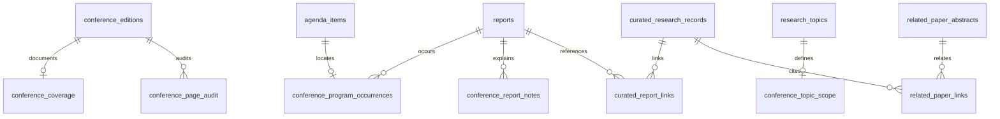

# ADA已有资料入库与本地会议视图

2026-11-17，未联网采集、未发布。原CDS数据及维护记录保留。

## 页面入口

[ADA本地会议视图](../../会议视图/ada.html)。顶部会议选择器可在CDS和ADA间切换，风格与原本地会议视图一致。

- **会议总览**：已有程序版本、解析覆盖、报告类型、议题和人物缺口。
- **议题数量与讲题**：数量榜与带头人对应讲题并列；可分别选择全部类型、口头/专题/大会、普通/晚期海报，分开统计，避免海报数量淹没口头议程。
- **全部报告**：保留未归类题目，支持编号、英文题名、姓名、类型及归类状态筛选；可进入原始程序PDF的物理页。
- **讲者信息**：姓名来源身份、现有角色层级、原文和缺口；程序未列单位时留空。
- **来源与统计口径**：原件清单、各层覆盖数字、去重规则和阅读层级。

## 本轮覆盖

| 层次 | 数量 | 含义 |
| --- | ---: | --- |
| 本地程序 | 385物理页 | 页眉2026-04-24；与页脚编号相差1，链接用物理页 |
| 编号Session | 242 | 原专题与主持独立保存 |
| 定时日程项目 | 2,859 | 含引介、讨论、活动等；逐行来源保留 |
| 学术展示发生项 | 2,621 | 同号可出现在普通海报及ePoster等不同位置 |
| 去重报告 | 2,539 | 同摘要编号合并82次重复展示；未编码讲题按独立程序时段保留 |
| 摘要编号覆盖 | 2,102 | 与完整本地TXT中所有OR/P/LB编号逐项比对一致 |
| 初分报告 | 2,049 | 56议题；题名规则1,907、专题辅助140、手动初审2 |
| 待归类 | 490 | 保留题名与来源，不算0，不强行归入泛主题 |
| 非本版学术报告日程 | 238 | 引介/讨论/行政活动或不在本版学术类型范围 |
| 未拆报告页面 | 12页 | 无Session编号的卫星会/活动介绍，原PDF和页审计保留 |
| 讲者姓名来源身份 | 2,096 | 仅姓名，不跨会议同名合并，不等于完全消歧自然人数 |
| 可暂定程序角色层级 | 2 | 美国ADA相关主席专业角色，暂列全国；其余2,094待定 |
| 已有精选研究笔记 | 27 | 记录中的设计/结果与程序题名层分开 |
| 结构化论文摘要 | 14 | 文件名虽写“原始摘要”，实际是论文摘要，非14篇会议原始摘要；另存A01原始关联XML |

| 数量榜范围 | 全部报告 | 已初分（榜单分母） | 待归类 |
| --- | ---: | ---: | ---: |
| 全部类型 | 2,539 | 2,049 | 490 |
| 口头／专题／大会 | 775 | 677 | 98 |
| 普通／晚期海报 | 1,764 | 1,372 | 392 |

数量榜同数并列，没有综合得分。报告类型、跨专题、人物分布和简介覆盖分别展示，不叠加。所属板块/关键词筛选不改变当前类型分母。

## 判断及资料缺口

程序是会前版本，不是已核实实际举行的全大会清单，也没有覆盖全会议研究结果。这里只把已有材料系统化，不升级其阅读层级。

英文题名规则辅助初分，不是579条CDS逐项复核的同等校准状态；沿用同层次问题边界，保留宽度和逐报告缺口。140条需依赖所在专题理解，尤其应优先校准。较宽议题数量仍受主题范围影响。CDS与ADA不能直接用原始数量或名次判断谁更热。

两条角色依据来自程序HCE-01和MSB-01的主席致辞位置。Amy Hess-Fischl与A. Enrique Caballero按标题及先后次序暂关联，仍缺完整履历和任期核验；不把国际会议、主持或获奖本身当作国际学术带头证据。角色引用可逐字符回读，但不计为完整实质简介。

论文作者与会议报告人分开。例如CONNECT（1170-OR）的程序报告人为Tom Martens，关联论文第一作者为Tamara K Oser。按编号能关联到程序项目，但结果/论文的版本关系仍独立留待核，不因多篇材料增加会议数量。

## 存储与表关系

当前数据库版本5，共40张表、18个视图。原31表的全部旧记录保留。为支持ADA海报，`reports.report_format`增加普通/晚期海报；讲者判断状态增加`provisional_program_role`。人物规则允许不同会议各自有当前版本，并核验每届会议每个来源身份只出现一次。

新增9表：

| 表 | 作用 |
| --- | --- |
| `conference_coverage` | 程序版本、原材料、覆盖数字、规则/方案及指纹、总缺口 |
| `conference_program_occurrences` | 同一报告在程序中的全部出现位置，主记录标记及物理页 |
| `conference_topic_scope` | 本版议题边界、宽度、CDS模板参照和缺口 |
| `conference_report_notes` | 逐报告初分方式、理由、交叉标签和证据缺口 |
| `conference_page_audit` | 每一物理页的解析状态与编号数量 |
| `curated_research_records` | 27条原有精选笔记，保留原JSON和出处 |
| `curated_report_links` | 精选记录与程序项目按编号/试验名关联；未核版本显式注明 |
| `related_paper_abstracts` | 14篇论文原始摘要的PMID、DOI、原题、作者、期刊及来源 |
| `related_paper_links` | 既有笔记与论文关联，不把论文另计会议报告 |



新视图：`v_ada_quantity_topic_counts`、`v_ada_quantity_board_counts`、`v_ada_quantity_topic_facts`、`v_ada_quantity_speaker_talks`。ADA分类版本的`analysis_kind=ada_topic_quantity`，不会混入CDS原来的数量视图。统计均从数据库只读导出。

## 复现与核验

```sh
python3 脚本/导入ADA.py
python3 脚本/生成会议视图.py
python3 脚本/生成ADA会议视图.py
python3 脚本/核验ADA资料.py
```

导入器同版本重跑只读跳过，规则或方案指纹改变会停止。当前维护台仍只维护CDS，不自动抓取或维护ADA；ADA更新后需重新运行ADA导出器。

入库前备份：`备份/ADA入库前_2026-11-17.db`及`备份/会议视图_ADA入库前_2026-11-17/`。来源9份原件与3份本地派生/规则资料逐文件校验，CDS436份原件及旧研究台保持。

[数据库核验](ADA入库核验.json) · [浏览器核验](../../会议视图/ADA浏览器核验.json) · [完整数量口径](ADA数量榜口径.md)

本轮已收窄T/B细胞、CGM及营养匹配规则；初版预览的2,073条调整为2,049条初分，未明确归类的24条转入待归类。先前初分方案留在备份目录，原始程序不变。
