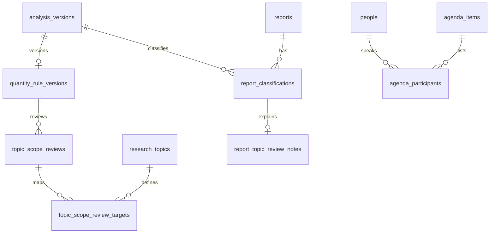

# CDS议题数量复核：字段与表关系增补

2026-11-17，数据库版本3。新增4张表、4个只读视图，合计28表、14视图。原24表中仅 `analysis_versions`、`research_topics`、`report_classifications` 追加本版记录；已有记录及其余21表不修改。原44议题仍可用原查询视图回读。

## 新增表

| 表 | 关键字段 | 用途 |
| --- | --- | --- |
| `quantity_rule_versions` | `analysis_version_id`、`previous_analysis_version_id`、`reviewed_on`、规则与决策文件路径及SHA256、`review_method`、`denominator`、`new_collection=0`、`scoring_enabled=0` | 固定新旧版本、规则与统计范围；判断方式为AI题名复核待校准 |
| `topic_scope_reviews` | 版本＋`old_topic_id`主键；`old_report_count`、`action`、`rationale`、`evidence_gaps` | 对全部44个旧议题记录保留、拆分或保留较宽集合的依据 |
| `topic_scope_review_targets` | 版本＋旧题＋新题主键；`width_status`、`boundary_text`、`evidence_gaps` | 旧定义→新定义；标明集中/较宽及纳入排除边界 |
| `report_topic_review_notes` | 版本＋报告主键；`previous_topic_id`、`decision_code`、理由、缺口、来源材料/定位 | 每个报告的新归类过程，含保留、拆分分流、调整归属、继续单列 |

新版分类使用 `analysis_versions.analysis_kind=topic_quantity`，旧版 `primary_topic` 不停用、不改写。新议题ID采用 `CDS2026:Q…`，保留旧 `H…` 和12个 `M…` 板块。新旧版本须显式选择，不能把两个版本的 `report_classifications` 混合计数。

新版58议题定义记录在数据库 `research_topics`，边界/缺口在复核表。该表的 `material_id` 继续指向旧定义资料作历史参考；新的判断依据应同时读取本版复核表与规则文件，不能把新分类当作主办方原始分类。报告分类的材料字段指向原始题名证据，分类结论由AI按本版规则形成。

## 新增查询视图

| 视图 | 粒度 | 内容 |
| --- | --- | --- |
| `v_cds_quantity_topic_counts` | 当前数量版每议题一行 | 去重报告数、固定分母579、占比、数量并列名次、宽度和边界；无综合得分 |
| `v_cds_quantity_board_counts` | 每板块一行 | 从子议题加总，合计579；只作导航分布 |
| `v_cds_quantity_topic_facts` | 每议题一行 | 报告类型、跨Session数量、讲者身份总数和三级＋待定分布、简介覆盖与无讲者报告数 |
| `v_cds_quantity_speaker_talks` | 议题×来源身份×报告 | 只连接主讲关系，不连接多条角色证据而重复报告；含人物层级、领域、任职状态、原题与来源 |

数量名次按报告数 `DENSE_RANK`，同数同名次，不用人物或报告类型打破并列。讲者数先对议题＋person_id去重，再统计各层级。报告类型互斥相加等于报告数；这些分项不再相加计分。



```sql
-- 新版数量榜；与旧 v_topic_counts（44议题）分开。
SELECT name,report_count,report_share_percent,quantity_rank,width_status
FROM v_cds_quantity_topic_counts ORDER BY report_count DESC,legacy_topic_id;
SELECT * FROM v_cds_quantity_topic_facts WHERE topic_id='CDS2026:Q33A';
SELECT display_name,domain_scope,title_original,source_url
FROM v_cds_quantity_speaker_talks
WHERE topic_id='CDS2026:Q33A' AND tier_code<>'undetermined';
```

## 复现与备份

- 分层规则和533条讲者身份未改。原始436份来源和旧研究台未改。
- `备份/CDS议题复核前_2026-11-17.db` 和 `备份/会议视图_议题复核前_2026-11-17/` 保留修改前版本。
- `脚本/准备CDS议题复核.py` 只读生成决策方案；`脚本/应用CDS议题复核.py` 事务追加，校验版本与指纹，同版本重跑跳过。
- `脚本/核验CDS议题量化.py` 复算当前版本并核查旧记录保留；初始及分层阶段的历史核验报告继续留存，不覆盖其历史含义。
- `脚本/生成会议视图.py` 只读使用上述新视图，并导出复核边界、分项事实、讲者讲题和逐条缺口。
