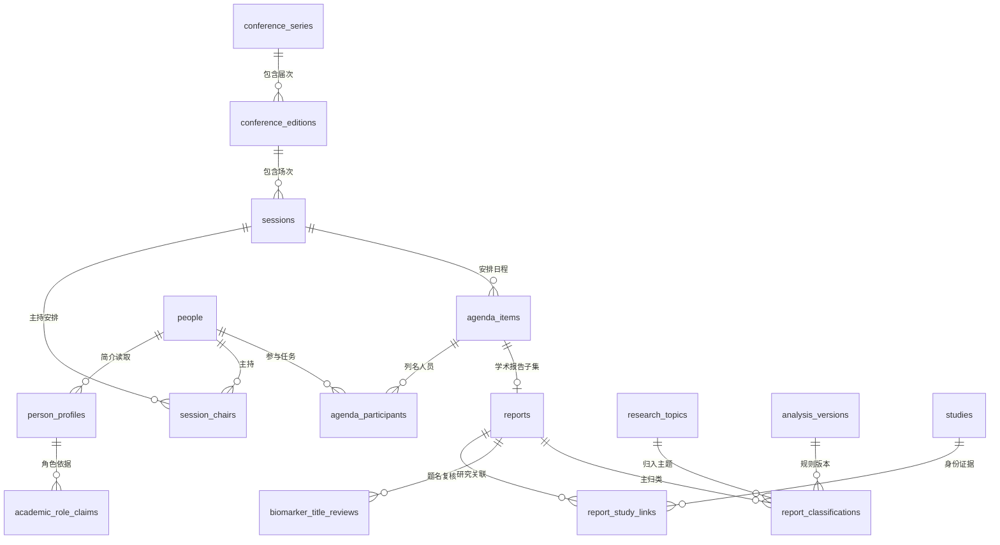

> 2026-11-17 ADA更新：当前40表/18视图，见[ADA字段与覆盖增补](ADA入库_2026-11-17/ADA资料覆盖与入库说明.md)。基础及分层历史字典保留。

> 2026-11-17更新：本篇保留首轮基础20表/6视图字典。分层阶段已追加至24表/10视图；当前议题数量复核已至28表/14视图，见[议题字段增补](CDS议题数量复核_2026-11-17/字段与表关系增补.md)。分层字段另见[分层字段与关系增补](讲者与会议分层_2026-11-17/字段与表关系增补.md)。

# 字段与表关系说明

数据库：`../数据库/marketing.db`。结构文件：`schema.sql`。本轮20张物理表、6个只读查询视图；资料时点2026-11-16，导入日期2026-11-17。

## 一、先怎样理解

- **事实与材料**：会议、场次、全部日程、学术报告、人员列名、官方简介及其来源。
- **分析判断**：旧议题归属、交叉标签、学术角色提取和标志物题名复核，保留来源与待校准状态；没有旧综合评分或3/2角色权重列。
- **研究身份**：`studies`与`report_study_links`本轮为空。606条是会前报告，不是606项独立研究。本项目其他地方已有的ADA/论文研究尚未导入本库，空表不代表那些研究不存在。
- **人员**：663条是姓名＋来源单位的身份条目，含主持及非学术列名；不是663位已确认PI。原学术报告范围533条人员ID保留。
- **原始文件**：原位置保留，另有436份随包镜像/处理依据。迁移依赖`source_materials.relative_path`；绝对`original_path`仅作溯源。

## 二、主要关系

材料表与导入批次及各事实/分析表通过外键相连，未全部画入图。每项关键记录可通过材料ID、相对路径和来源定位回查原文。`research_topics`通过父节点连接12个板块与44个具体议题。

## 三、各表与字段

以下字段由实际数据库结构生成；PK是主键，FK是外键。NULL表示字段尚未取得/未适用，具体原因看状态与说明；不代替0。`is_current_snapshot=1`是当前快照，不表示方法已获批准。

### `import_batches`｜导入批次、快照指纹与来源时点

当前1条。

| 字段 | 类型 | 约束/关联 | 含义 |
|---|---|---|---|
| `import_id` | TEXT | PK1；必填 | 导入批次ID |
| `fingerprint` | TEXT | 必填 | 本批资料清单的指纹 |
| `imported_on` | TEXT | 必填 | 业务导入日期（本轮2026-11-17） |
| `imported_at` | TEXT | 必填 | 执行时记录的UTC时间 |
| `source_observed_on` | TEXT | 必填 | 原资料时点，不作为发表日 |
| `source_manifest` | TEXT | 必填 | 随包资料清单相对路径 |
| `importer_version` | TEXT | 必填 | 导入器版本 |
| `new_collection` | INTEGER | 必填 | 本轮是否新增采集；固定0 |
| `notes` | TEXT | 必填 | 批次范围及口径说明 |

### `source_materials`｜随包原始/处理材料及可迁移路径

当前436条。

| 字段 | 类型 | 约束/关联 | 含义 |
|---|---|---|---|
| `material_id` | TEXT | PK1；必填 | 材料ID；由相对路径和内容指纹生成 |
| `import_id` | TEXT | 必填；FK → import_batches.import_id | 导入批次ID |
| `relative_path` | TEXT | 必填 | 相对数据中心根目录的路径 |
| `sha256` | TEXT | 必填 | 文件内容SHA256 |
| `byte_size` | INTEGER | 必填 | 文件字节数 |
| `material_kind` | TEXT | 必填 | 官方HTML/结构化文件/既有处理依据等 |
| `source_url` | TEXT | 可空 | 已有原始网址；本轮未重新访问 |
| `reading_level` | TEXT | 必填 | 资料或读取层次 |
| `source_observed_on` | TEXT | 可空 | 原资料时点，不作为发表日 |
| `original_path` | TEXT | 必填 | 原机器来源路径，仅作溯源；迁移后不用于读文件 |
| `original_sha256` | TEXT | 必填 | 原来源文件指纹；衍生映射与原文件可不同 |
| `is_derived` | INTEGER | 必填 | 是否是本次从既有资料抽取的映射快照 |

### `conference_series`｜会议系列（工作规范名，原始当届名见conference_editions）

当前1条。

| 字段 | 类型 | 约束/关联 | 含义 |
|---|---|---|---|
| `series_id` | TEXT | PK1；必填 | 会议系列ID |
| `abbreviation` | TEXT | 必填 | 简称 |
| `name_original` | TEXT | 必填 | 该次原始列名，保留致辞等前缀 |
| `evidence_material_id` | TEXT | 必填；FK → source_materials.material_id | 支持本条记录的材料ID |

### `conference_editions`｜具体会议届次与元数据、缺口

当前1条。

| 字段 | 类型 | 约束/关联 | 含义 |
|---|---|---|---|
| `conference_id` | TEXT | PK1；必填 | 具体会议届次ID |
| `series_id` | TEXT | 必填；FK → conference_series.series_id | 会议系列ID |
| `year` | INTEGER | 必填 | 年份 |
| `edition_label` | TEXT | 可空 | 原届次文字 |
| `name_original` | TEXT | 必填 | 该次原始列名，保留致辞等前缀 |
| `organizer` | TEXT | 可空 | 主办方；本轮未核，NULL |
| `region` | TEXT | 可空 | 国内/国际原分类 |
| `country` | TEXT | 可空 | 举办国；本轮未独立核清，NULL |
| `city` | TEXT | 可空 | 既有日历地点（厦门） |
| `format` | TEXT | 可空 | 线上/线下形式；本轮未核，NULL |
| `start_date` | TEXT | 可空 | 开始日期（既有依据） |
| `end_date` | TEXT | 可空 | 结束日期（既有依据） |
| `local_timezone` | TEXT | 可空 | 解释本地日程所用时区 |
| `timezone_basis` | TEXT | 可空 | 时区推定依据，不冒充原文显式字段 |
| `official_url` | TEXT | 可空 | 原有官方入口 |
| `metadata_status` | TEXT | 必填 | 元数据核查状态 |
| `metadata_material_id` | TEXT | 必填；FK → source_materials.material_id | 元数据来源材料 |
| `source_locator` | TEXT | 必填 | 原材料中的JSON位置/段落定位 |
| `metadata_gaps` | TEXT | 必填 | 明确尚缺的元数据 |

### `sessions`｜官方专题/场次结构，区别于自建研究主题

当前148条。

| 字段 | 类型 | 约束/关联 | 含义 |
|---|---|---|---|
| `session_id` | TEXT | PK1；必填 | 数据库场次ID |
| `conference_id` | TEXT | 必填；FK → conference_editions.conference_id | 具体会议届次ID |
| `source_session_id` | TEXT | 必填 | 官方场次编号 |
| `title_original` | TEXT | 必填 | 原始标题 |
| `date_original` | TEXT | 可空 | 原始日期文字 |
| `local_date` | TEXT | 可空 | 从原文解析的当地日期 |
| `room_original` | TEXT | 可空 | 原始会场文字 |
| `material_id` | TEXT | 必填；FK → source_materials.material_id | 材料ID；由相对路径和内容指纹生成 |
| `source_locator` | TEXT | 必填 | 原材料中的JSON位置/段落定位 |

### `agenda_items`｜全部797条日程，保留非学术内容及原始JSON

当前797条。

| 字段 | 类型 | 约束/关联 | 含义 |
|---|---|---|---|
| `agenda_item_id` | TEXT | PK1；必填 | 本批原始日程条目ID |
| `conference_id` | TEXT | 必填；FK → conference_editions.conference_id | 具体会议届次ID |
| `session_id` | TEXT | 必填；FK → sessions.session_id | 数据库场次ID |
| `source_code` | TEXT | 可空 | 原报告编号，无编号则NULL |
| `source_order` | INTEGER | 必填 | 原始JSON行序，0起 |
| `title_original` | TEXT | 必填 | 原始标题 |
| `format_original` | TEXT | 必填 | 原发言类型 |
| `date_original` | TEXT | 可空 | 原始日期文字 |
| `local_date` | TEXT | 可空 | 从原文解析的当地日期 |
| `time_original` | TEXT | 可空 | 原时间文字 |
| `start_time` | TEXT | 可空 | 可解析的开始时间，不能解析则NULL |
| `end_time` | TEXT | 可空 | 可解析的结束时间，不能解析则NULL |
| `room_original` | TEXT | 可空 | 原始会场文字 |
| `source_url` | TEXT | 可空 | 已有原始网址；本轮未重新访问 |
| `evidence_level` | TEXT | 必填 | 本轮为planned_agenda（计划日程） |
| `material_id` | TEXT | 必填；FK → source_materials.material_id | 材料ID；由相对路径和内容指纹生成 |
| `source_locator` | TEXT | 必填 | 原材料中的JSON位置/段落定位 |
| `raw_json` | TEXT | 必填 | 逐条保留完整原始结构，不丢未建模字段 |

### `reports`｜606条学术报告的核心记录；仅本轮已有题名，无研究结果

当前606条。

| 字段 | 类型 | 约束/关联 | 含义 |
|---|---|---|---|
| `report_id` | TEXT | PK1；必填 | 稳定报告ID：CDS2026:官方报告编号 |
| `agenda_item_id` | TEXT | 必填；FK → agenda_items.agenda_item_id | 本批原始日程条目ID |
| `conference_id` | TEXT | 必填；FK → conference_editions.conference_id | 具体会议届次ID |
| `source_report_code` | TEXT | 必填 | 官方报告编号 |
| `legacy_report_id` | TEXT | 必填 | 原工作台报告ID（如S_001） |
| `legacy_evidence_id` | TEXT | 必填 | 原证据ID（如C-S_001） |
| `report_format` | TEXT | 必填 | 大会报告/专题报告/论文发言 |
| `evidence_status` | TEXT | 必填 | 本轮均agenda_only；后续可按证据更新 |
| `has_results` | INTEGER | 必填 | 本轮0，表示未导入报告结果 |
| `result_text` | TEXT | 可空 | 本轮NULL，不从题名补结果 |
| `independent_study_status` | TEXT | 必填 | 研究身份状态；本轮not_established |

### `people`｜来源身份条目，不是完整消歧的自然人或独立PI名单

当前663条。

| 字段 | 类型 | 约束/关联 | 含义 |
|---|---|---|---|
| `person_id` | TEXT | PK1；必填 | 来源身份ID，基于姓名/原文单位匹配键 |
| `source_identity_key` | TEXT | 必填 | 去空格后的姓名＋原文单位；角色前缀另处理 |
| `display_name` | TEXT | 必填 | 展示名，保留中英文姓名差异 |
| `institution_source` | TEXT | 必填 | 来源的单位文字，未自动标准化为机构主档 |
| `identity_status` | TEXT | 必填 | 身份核查状态；本轮未完整消歧 |
| `legacy_person_id` | TEXT | 可空 | 原CDS工作台人员ID加会议前缀（533条有值） |
| `mapping_material_id` | TEXT | 必填；FK → source_materials.material_id | 匹配/映射依据材料 |
| `identity_note` | TEXT | 必填 | 身份匹配边界说明 |

### `agenda_participants`｜日程条目中的列名人员及任务角色

当前772条。

| 字段 | 类型 | 约束/关联 | 含义 |
|---|---|---|---|
| `agenda_item_id` | TEXT | PK1；必填；FK → agenda_items.agenda_item_id | 本批原始日程条目ID |
| `ordinal` | INTEGER | PK2；必填 | 该原列表中的顺序，0起 |
| `person_id` | TEXT | 必填；FK → people.person_id | 来源身份ID，基于姓名/原文单位匹配键 |
| `agenda_role` | TEXT | 必填 | speaker/address/discussant/summary/session_talk/listed_person |
| `name_original` | TEXT | 必填 | 该次原始列名，保留致辞等前缀 |
| `institution_original` | TEXT | 必填 | 该次原文单位 |
| `profile_url` | TEXT | 可空 | 已有官方简介地址 |
| `role_basis` | TEXT | 必填 | 任务角色的解释依据 |

### `session_chairs`｜官方场次主持关系；不当作报告主讲计数

当前291条。

| 字段 | 类型 | 约束/关联 | 含义 |
|---|---|---|---|
| `session_id` | TEXT | PK1；必填；FK → sessions.session_id | 数据库场次ID |
| `ordinal` | INTEGER | PK2；必填 | 该原列表中的顺序，0起 |
| `person_id` | TEXT | 必填；FK → people.person_id | 来源身份ID，基于姓名/原文单位匹配键 |
| `name_original` | TEXT | 必填 | 该次原始列名，保留致辞等前缀 |
| `institution_original` | TEXT | 必填 | 该次原文单位 |
| `profile_url` | TEXT | 可空 | 已有官方简介地址 |

### `person_profiles`｜简介的真实读取状态、提取文本、失败与材料

当前230条。

| 字段 | 类型 | 约束/关联 | 含义 |
|---|---|---|---|
| `profile_id` | TEXT | PK1；必填 | 该次简介读取记录ID |
| `person_id` | TEXT | 必填；FK → people.person_id | 来源身份ID，基于姓名/原文单位匹配键 |
| `import_id` | TEXT | 必填；FK → import_batches.import_id | 导入批次ID |
| `profile_url` | TEXT | 必填 | 已有官方简介地址 |
| `read_status` | TEXT | 必填 | read或unavailable，失败不抹掉 |
| `has_substantive_bio` | INTEGER | 必填 | 既有复核是否有实质简介，非仅单位 |
| `extracted_text` | TEXT | 可空 | 原有提取文本，可能包含简介与学术任务 |
| `fetch_error` | TEXT | 可空 | 原有失败/重试信息 |
| `raw_material_id` | TEXT | FK → source_materials.material_id | 已取得的简介原始文件；失败则可NULL |
| `evidence_material_id` | TEXT | 必填；FK → source_materials.material_id | 支持本条记录的材料ID |
| `source_locator` | TEXT | 必填 | 原材料中的JSON位置/段落定位 |
| `source_observed_on` | TEXT | 可空 | 原资料时点，不作为发表日 |

### `academic_role_claims`｜已有官方简介中的学术角色线索，不是客户评级或任期认证

当前174条。

| 字段 | 类型 | 约束/关联 | 含义 |
|---|---|---|---|
| `claim_id` | TEXT | PK1；必填 | 角色线索ID |
| `person_id` | TEXT | 必填；FK → people.person_id | 来源身份ID，基于姓名/原文单位匹配键 |
| `profile_id` | TEXT | FK → person_profiles.profile_id | 该次简介读取记录ID |
| `role_phrase` | TEXT | 必填 | 已有提取的具体任职/角色短语 |
| `role_level` | TEXT | 必填 | 既有全国/领域或区域/专科标签，不带分值 |
| `tenure_status` | TEXT | 必填 | historical_mentioned或not_independently_verified |
| `source_material_id` | TEXT | 必填；FK → source_materials.material_id | 支持该线索的材料 |
| `source_locator` | TEXT | 必填 | 原材料中的JSON位置/段落定位 |
| `source_note` | TEXT | 必填 | 来源和历任/核查边界 |
| `verification_status` | TEXT | 必填 | 本轮conference_bio_claim，尚非独立任期认证 |

### `analysis_versions`｜已有分类/复核的版本与状态；评分未启用

当前2条。

| 字段 | 类型 | 约束/关联 | 含义 |
|---|---|---|---|
| `analysis_version_id` | TEXT | PK1；必填 | 归类/复核版本ID |
| `conference_id` | TEXT | 必填；FK → conference_editions.conference_id | 具体会议届次ID |
| `analysis_kind` | TEXT | 必填 | primary_topic或biomarker_title_scope |
| `rule_label` | TEXT | 必填 | 分析规则名称 |
| `review_status` | TEXT | 必填 | 复核/待核状态；在分类表中保留原状态文字 |
| `is_current_snapshot` | INTEGER | 必填 | 仅表示当前导入快照的默认查询版本，非导师批准 |
| `scoring_enabled` | INTEGER | 必填 | 本轮0，不导入旧综合分 |
| `material_id` | TEXT | 必填；FK → source_materials.material_id | 材料ID；由相对路径和内容指纹生成 |
| `method_note` | TEXT | 必填 | 规则用途与方法边界 |

### `research_topics`｜12个工作板块与44个具体议题，自建分类

当前56条。

| 字段 | 类型 | 约束/关联 | 含义 |
|---|---|---|---|
| `topic_id` | TEXT | PK1；必填 | 研究主题节点ID |
| `conference_id` | TEXT | 必填；FK → conference_editions.conference_id | 具体会议届次ID |
| `legacy_topic_id` | TEXT | 必填 | 原Mxx/Hxx编号 |
| `parent_topic_id` | TEXT | FK → research_topics.topic_id | 工作板块父节点；板块无父节点 |
| `node_type` | TEXT | 必填 | board或topic |
| `name` | TEXT | 必填 | 工作名称 |
| `research_question` | TEXT | 可空 | 具体研究问题；板块可空 |
| `taxonomy_status` | TEXT | 必填 | working_classification（工作分类） |
| `material_id` | TEXT | 必填；FK → source_materials.material_id | 材料ID；由相对路径和内容指纹生成 |

### `report_classifications`｜606条报告的已有主归属或排除状态，属于分析判断

当前606条。

| 字段 | 类型 | 约束/关联 | 含义 |
|---|---|---|---|
| `report_id` | TEXT | PK1；必填；FK → reports.report_id | 稳定报告ID：CDS2026:官方报告编号 |
| `analysis_version_id` | TEXT | PK2；必填；FK → analysis_versions.analysis_version_id | 归类/复核版本ID |
| `primary_topic_id` | TEXT | FK → research_topics.topic_id | 唯一主议题；排除条目为空 |
| `scope_original` | TEXT | 必填 | 原入榜/培训/科研方法/综合待细分状态 |
| `eligible` | INTEGER | 必填 | 当前分类范围是否计数，不表示研究质量 |
| `classification_basis` | TEXT | 必填 | 既有题名归类理由 |
| `material_id` | TEXT | 必填；FK → source_materials.material_id | 材料ID；由相对路径和内容指纹生成 |
| `source_locator` | TEXT | 必填 | 原材料中的JSON位置/段落定位 |

### `report_tags`｜交叉技术/问题标签，不重复增加报告数

当前172条。

| 字段 | 类型 | 约束/关联 | 含义 |
|---|---|---|---|
| `report_id` | TEXT | PK1；必填；FK → reports.report_id | 稳定报告ID：CDS2026:官方报告编号 |
| `analysis_version_id` | TEXT | PK2；必填；FK → analysis_versions.analysis_version_id | 归类/复核版本ID |
| `tag` | TEXT | PK3；必填 | 交叉标签，不额外计数 |
| `material_id` | TEXT | 必填；FK → source_materials.material_id | 材料ID；由相对路径和内容指纹生成 |

### `biomarker_title_reviews`｜606条题名的已有标志物复核结论

当前606条。

| 字段 | 类型 | 约束/关联 | 含义 |
|---|---|---|---|
| `report_id` | TEXT | PK1；必填；FK → reports.report_id | 稳定报告ID：CDS2026:官方报告编号 |
| `analysis_version_id` | TEXT | PK2；必填；FK → analysis_versions.analysis_version_id | 归类/复核版本ID |
| `review_status` | TEXT | 必填 | 复核/待核状态；在分类表中保留原状态文字 |
| `in_denominator` | INTEGER | 必填 | 是否纳入本轮80条标志物相关题名范围 |
| `target_text` | TEXT | 可空 | 题名明确特征/候选；非已验证Biomarker |
| `use_text` | TEXT | 可空 | 题名层临床用途或关联 |
| `indicator_kind` | TEXT | 可空 | 分子/指标/影像等类型 |
| `basis` | TEXT | 必填 | 已有判断依据 |
| `review_level` | TEXT | 必填 | 题名层AI复核及待校准说明 |
| `material_id` | TEXT | 必填；FK → source_materials.material_id | 材料ID；由相对路径和内容指纹生成 |
| `source_locator` | TEXT | 必填 | 原材料中的JSON位置/段落定位 |

### `legacy_marker_bindings`｜7条报告与既有词条ID的分析关联，非临床验证结论

当前7条。

| 字段 | 类型 | 约束/关联 | 含义 |
|---|---|---|---|
| `report_id` | TEXT | PK1；必填；FK → reports.report_id | 稳定报告ID：CDS2026:官方报告编号 |
| `analysis_version_id` | TEXT | PK2；必填；FK → analysis_versions.analysis_version_id | 归类/复核版本ID |
| `legacy_marker_id` | TEXT | PK3；必填 | 既有词条ID；本轮仅保留来源映射，未导入完整指标库 |
| `evidence_id_original` | TEXT | 必填 | 原证据ID |
| `binding_status` | TEXT | 必填 | 既有题名绑定，待进一步复核 |
| `material_id` | TEXT | 必填；FK → source_materials.material_id | 材料ID；由相对路径和内容指纹生成 |
| `source_locator` | TEXT | 必填 | 原材料中的JSON位置/段落定位 |

### `studies`｜独立研究身份入口；本轮为空，报告不自动成为研究

当前0条。

| 字段 | 类型 | 约束/关联 | 含义 |
|---|---|---|---|
| `study_id` | TEXT | PK1；必填 | 研究身份ID，不与报告编号等同 |
| `title` | TEXT | 可空 | 研究标题 |
| `identity_status` | TEXT | 必填 | 身份核查状态；本轮未完整消歧 |
| `doi` | TEXT | 可空 | 已核DOI |
| `trial_registration` | TEXT | 可空 | 已核注册号 |
| `cohort_description` | TEXT | 可空 | 队列/样本描述 |
| `source_material_id` | TEXT | 必填；FK → source_materials.material_id | 支持该线索的材料 |

### `report_study_links`｜报告与研究的关联证据；本轮为空

当前0条。

| 字段 | 类型 | 约束/关联 | 含义 |
|---|---|---|---|
| `report_id` | TEXT | PK1；必填；FK → reports.report_id | 稳定报告ID：CDS2026:官方报告编号 |
| `study_id` | TEXT | PK2；必填；FK → studies.study_id | 研究身份ID，不与报告编号等同 |
| `relation_type` | TEXT | PK3；必填 | confirmed_same_study/possible_overlap/shared_cohort/pending |
| `basis` | TEXT | 必填 | 已有判断依据 |
| `material_id` | TEXT | 必填；FK → source_materials.material_id | 材料ID；由相对路径和内容指纹生成 |

## 四、查询视图（不保存第二份事实，不含综合评分）

| 视图 | 行粒度 | 用途与范围 |
|---|---|---|
| `v_conference_inventory` | 每届会议 | 会议元数据、148专题、797日程、606学术报告。 |
| `v_report_detail` | 每条学术报告 | 原题、时间、会场、来源、讲者摘要；固定606行，不因多讲者重复增行。 |
| `v_topic_counts` | 当前版本的每个具体议题 | 44题，按唯一报告计数；分母由既有归类动态复算为579，不写死在网页。 |
| `v_board_counts` | 当前版本的每个工作板块 | 12板块，汇总主议题计数；合计579，跨标签不重复。 |
| `v_leader_talks` | 报告×人员 | 有官方简介角色线索者在讲什么；一人多条角色先合并，不按角色条数重复计发言。不是客户评级。 |
| `v_biomarker_title_scope` | 当前版本各复核类别 | 复现606条题名处理范围；80条相关、7条已绑定、73条待细分另可查询。 |

议题分母579与标志物题名分母80是不同分析范围，不能混用。人数、报告数、独立研究数也不能互换。所有比例只描述当前已归类会议内容；没有据此生成热度总分。

## 五、身份、来源和待核状态

- 会议：`CDS2026`；报告如`CDS2026:OR_262`，原编号`OR_262`和原证据ID`C-OR_262`均保留。
- 原人员编号如`CDS2026:E021`在`legacy_person_id`保留；匹配键为姓名和原文单位去空格。非学术列名的“致辞/讨论/总结/主持”等前缀仅作匹配清理，原写法留在关系表。
- 227条简介读取成功，其中196条有实质简介；3条失败入口和错误保留。角色表174条短语涉及126个来源身份，其中115人关联既有579条统计范围。任期未独立核验，不把多位同职务者认定为同时在任。
- 主办方、举办国、形式等本包没有充分依据的元数据留空；厦门及日期沿用旧日历，时区按所在地解释并单列依据。
- 旧工作分类和80条标志物题名判断保持“待方法/mentor复核”；原始处理JSON可含历史权重字段，作为来源文件保存，不作为本库活动评分导入。

## 六、维护与迁移

当前导入器支持本批CDS首次导入和相同指纹的只读重跑跳过；来源变化或不同批次遇到现有数据库会停止，不覆盖、不擅自合并。新增会议、论文与研究结果需随后设计增量更新及迁移规则。

迁移应复制整个数据中心，包括数据库、原始资料、规则与脚本；只复制`.db`可查询已存结构，但会失去文件证据。Windows读取使用UTF-8启动参数。原机器绝对路径仅留作历史，不参与随包导入。

现有网页没有改为读本库，网页生成器、现行评分、GitHub和自动任务均未改动。`网页导出/CDS首轮查询样例.json`只是SQL查询样例，不是已应用的正式网页数据。
