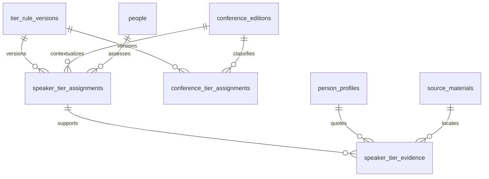

# 讲者与会议分层：字段及表关系增补

2026-11-17，数据库版本由1升级为2。原20张表的全部记录保持；新增4张表及4个查询视图，共24表、10视图。基础字段仍见[原字段字典](../字段与表关系说明.md)，本增补专门说明新增部分。

## 表及字段

| 表 | 主键 | 主要字段与含义 |
| --- | --- | --- |
| `tier_rule_versions` | `rule_version_id` | `label`规则名称，`assessed_on`判断日期，`source_snapshot_date`原资料日期，`rule_path/rule_sha256`规则文件及指纹，`decisions_path/decisions_sha256`选择记录及指纹，`assessment_method`判断方式，`current_snapshot`当前版本标记，`new_collection=0`无新采集 |
| `speaker_tier_assignments` | `conference_id + person_id + rule_version_id` | `tier_code`国际/全国/区域/待定，`domain_scope`该角色涉及的领域及地域，`assessment_status`原简介暂定/证据不足，`tenure_status`任职状态，`rationale`理由，`evidence_gaps`缺口 |
| `speaker_tier_evidence` | `evidence_id` | 外键关联上述讲者判断；`profile_id`原简介，`source_material_id`原读取材料，`source_locator`具体原文位置，`quote_original`原文摘录，`context_original`相邻原文，`char_start/char_end`简介文本内的Unicode字符范围（左含右不含），`evidence_kind`组织角色/全国研究指南牵头/全国研究基础设施 |
| `conference_tier_assignments` | `conference_id + rule_version_id` | `tier_code`国际核心/国内全国性大型/区域重点/待定，`scope_label`覆盖范围说明，`assessment_status`用户已确认/暂定/不足，`basis_type/basis_text`依据类型及内容，`source_material_id/source_locator`已有资料参考，`evidence_gaps`其余缺口 |

枚举值：

- 讲者 `tier_code`：`international`、`national`、`regional`、`undetermined`。
- 讲者 `assessment_status`：`provisional_existing_bio`（有原文的暂定分层）、`insufficient_evidence`（证据不足待定）。暂定不等于待定。
- 任职状态：`term_unverified`、`historical`、`honorary`、`chair_elect`、`dated_term_unverified`、`not_applicable`。
- 会议 `tier_code`：`international_core`、`national_major`、`regional_key`、`undetermined`。CDS为 `national_major`，`assessment_status=user_confirmed`。

`domain_scope` 是版本化的判断字段，按职务及其组织范围填写，并非已确认的完整研究方向；本届报告议题仍通过 `reports → report_classifications → research_topics` 查询。两者不互相替代。

## 表关系



讲者每届会议、每版本一条分层；同名不同单位不合并。已分层条目至少一条原文证据；待定条目保存不足原因。只有学术报告讲者的533条来源身份进入本版分层，主持身份未因此自动变成讲者。

## 查询视图

| 视图 | 行粒度与用途 |
| --- | --- |
| `v_speaker_tiers` | 当前版本，一位讲者来源身份一行，含标签、范围、状态、证据条数 |
| `v_speaker_tier_counts` | 每届会议×层级的来源身份计数 |
| `v_conference_tiers` | 当前版本每届会议的层级及依据，与举办地点分开 |
| `v_tier_speaker_talks` | 讲者来源身份×报告；只连接主讲，不把主持混入，不因多条证据重复报告 |

```sql
SELECT tier_label, identity_count FROM v_speaker_tier_counts;
SELECT display_name, institution_source, tier_label, domain_scope,
       tenure_status, evidence_count
FROM v_speaker_tiers WHERE tier_code <> 'undetermined';
SELECT display_name, domain_scope, title_original, source_url
FROM v_tier_speaker_talks WHERE tier_code = 'international';
SELECT c.name_original,t.tier_label,c.city,c.country,t.basis_text
FROM conference_editions c JOIN v_conference_tiers t USING(conference_id);
```

## 本版结果及复核

533条讲者来源身份：国际6、全国96、区域／专科43、待定388。145条已暂定层级，150条原文摘录，均能逐字符回读。会议简介是来源事实，层级及领域是AI按规则形成的判断，尚待人工确认。

例子：Alicia Jenkins为国际（限IDF西太平洋）；Julia Mader为国际（EASD教育委员会）；郭立新为全国（糖尿病）；何庆为区域（天津糖尿病）。两位肖新华分别保留北京协和与南华大学来源身份，并分别依据各自简介判断，不能共享职务。

原日程、报告、原角色提取及题目分类表均未修改；议题数量仍按579条报告去重计算，无新增综合评分。会议层级不影响报告或议题计数。

## 执行及备份

- 原始结构保留于 `规则与说明/schema.sql`，增量结构见 `规则与说明/002_讲者与会议分层.sql`。
- 分层前数据库：`备份/CDS分层前_2026-11-17.db`；分层前会议视图及生成器保留在 `备份/会议视图_分层前_2026-11-17/`。
- `脚本/应用CDS分层.py` 校验变更前指纹后事务迁移；同版本同规则重跑跳过，规则变更则停止并要求新版本，不覆盖现有判断。
- `脚本/生成会议视图.py` 继续只读导出；页面不是实时连接数据库。
- 整库复制到其他电脑时，一起复制规则、证据与备份目录。旧初始导入核验是历史记录；当前版本见本目录分层核验及会议视图核验。
